# Hermes Evals: every UI feature, end to end

This document walks through everything a user can do in the UI. For each feature it shows what the user does, which API calls the web app makes, what the API writes to Postgres, which jobs it queues, and what the worker, docker-guard, egress and the trial container do with them.

It is written for review. It follows `IMPLEMENTATION_PLAN.md` (the source of truth), the design canvas, and the code as it stands on 24 Oct 2026. Where those three disagree, or where something is not decided, the flow says so and the point is collected in [section 19, Open points](#19-open-points-found-while-writing-this).

## How to read this

- **Built** means code exists and is tested today. **Planned** means it is specified in the plan but not written yet. Each feature section starts with a status line.
- Diagrams use these participants:

| Name      | What it is                                                                                                               |
| --------- | ------------------------------------------------------------------------------------------------------------------------ |
| User      | The person in the browser                                                                                                |
| Web       | The Vue app (served by nginx, `/api` proxied to the API)                                                                 |
| API       | NestJS HTTP API. Validates, writes Postgres, queues jobs, serves reads and SSE. Never talks to Docker                    |
| DB        | PostgreSQL: the tables in section 2, plus pg-boss's job tables                                                           |
| Queue     | pg-boss, inside the same Postgres. Jobs are rows, so "write rows and queue jobs" commits in one transaction              |
| Worker    | NestJS worker process. Claims jobs, prepares trial folders, drives trials through the guard, writes events, runs scorers |
| Guard     | docker-guard: the only process holding the Docker socket. Starts nothing but hardened trial containers                   |
| Egress    | The trial's only network path out: CONNECT proxy plus model gateway. Holds API keys. Counts tokens per attempt           |
| Trial     | One container per attempt, running Hermes once (`hermes chat --oneshot --format stream-json`)                            |
| NousLogin | `nous-login` service: runs Hermes's device login and writes the login into the `nous-home` volume                        |
| NousProxy | `nous-proxy` service: `hermes proxy start --provider nous`, reads that login, forwards model calls to Nous Portal        |
| Disk      | `./suites` on disk (read by the loader only) and the blob store under `DATA_DIR/blobs/<sha256>`                          |

## Contents

1. [System map](#1-system-map)
2. [Data model](#2-data-model)
3. [State machines](#3-state-machines)
4. [App shell: navigation, banners, live pills](#4-app-shell-navigation-banners-live-pills)
5. [System page](#5-system-page)
6. [Connecting Nous Portal](#6-connecting-nous-portal)
7. [Nudges: where the UI blocks model work and why](#7-nudges-where-the-ui-blocks-model-work-and-why)
8. [Suites and tasks](#8-suites-and-tasks)
9. [Resources: skills, documents, MCP servers, secrets](#9-resources-skills-documents-mcp-servers-secrets)
10. [Configurations](#10-configurations)
11. [New experiment and launch](#11-new-experiment-and-launch)
12. [What happens to one run: execution](#12-what-happens-to-one-run-execution)
13. [What happens to one run: scoring](#13-what-happens-to-one-run-scoring)
14. [Experiment list and overview, live](#14-experiment-list-and-overview-live)
15. [Experiment controls](#15-experiment-controls)
16. [Comparison tab](#16-comparison-tab)
17. [Runs tab](#17-runs-tab)
18. [Run inspector](#18-run-inspector)
19. [Open points found while writing this](#19-open-points-found-while-writing-this)

---

## 1. System map

Status: **Built** (Phases 0 to 3): postgres, the api with every Phase 1 to Phase 3 endpoint, re-score included, the worker (isolation self-test, suite loader, MCP test, `execute-run`, `evaluate-run` with all eight scorers and its dead letter, recovery), docker-guard, egress (proxy, model gateway with its per-attempt token cap, MCP gateway, the LLM judge's path on the admin socket), the trial image, nous-proxy and nous-login. The web app is built against fixtures. **Planned**: statistics and the comparison endpoint (Phase 4), the pages against the real API (Phase 5), suite authoring (Phase 5b).

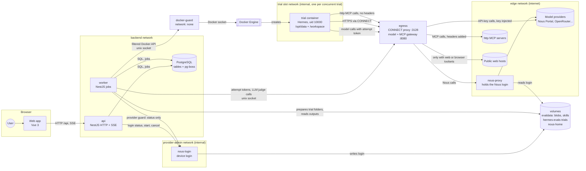

What the picture enforces:

- The trial can reach **only egress**. Postgres, the API, the host, other trials and the internet are not on its network. Its filesystem is two mounts: its own home (`/opt/data`) and workspace (`/workspace`).
- **No provider credential enters a trial.** The trial gets a per-attempt token. Egress swaps it for the real API key, or forwards Nous calls to nous-proxy, which holds the OAuth login. The token dies when the attempt ends. The same holds for http MCP header values, which egress adds. The one exception is a stdio MCP server's env values: that server runs inside the trial, so the agent can read them, and the UI says so (section 9.4).
- **The worker and the API hold no provider key either.** Compose blanks every key in their environments, and the LLM judge's model calls go through egress's admin socket, one short-lived registration per judge call (section 13).
- **Only docker-guard can touch Docker**, and it refuses anything that is not a trial container of the pinned image with the hardened settings.
- The API never talks to Docker. The worker never serves HTTP.

---

## 2. Data model

Status: **Built** (migrations 0000 to 0005, integrity triggers, tests on PGlite and Postgres 17). Migration 0004 added the `provider_disconnected` pause reason and `workers.host_proxy`; 0005 added `runs.next_trigger` and the `over_budget` artifact reason. **Planned**: the suite draft tables (Phase 5b).

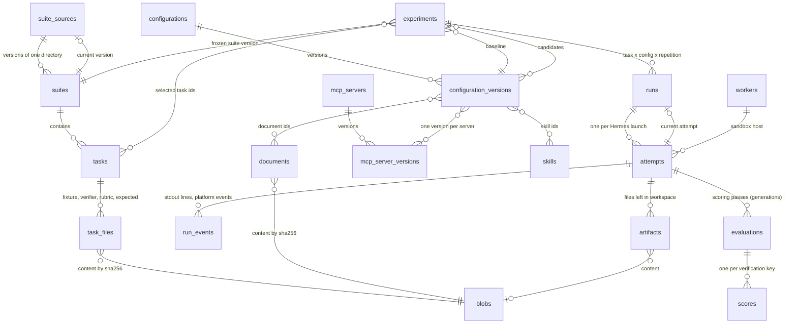

The rules that matter for every flow below, all enforced by the database whatever code path writes:

- **Evidence is immutable.** Events, artifacts and scores are append-only. Suites, tasks, task files, skills, documents and blobs never change. Runs, attempts, experiments and evaluations are never deleted.
- **Only the lease holder writes.** Events and artifacts can be added only while their attempt is `running` and its lease is not revoked. Every worker write is fenced on the lease token.
- **Experiments freeze what they test.** Launch needs frozen configuration versions and valid tasks of the experiment's own suite version.
- **Publishing a score set is strict.** It needs the run's current attempt and exactly the task's declared keys, and fails if a newer generation is already published.
- **`results_revision`** on the experiment goes up whenever a run changes status or a score set is published or superseded. The comparison cache and the verdict history key off it.
- **Lock order** in every status-changing transaction: experiment, then runs, attempts, evaluations.

---

## 3. State machines

Status: **Built** as vocabularies and database checks, and the API and worker code that performs the transitions (Phase 2; `docs/phases/phase-2.md` section 3.5), with the re-score transitions of an evaluation (Phase 3; `docs/phases/phase-3.md` section 3.2).

### Run

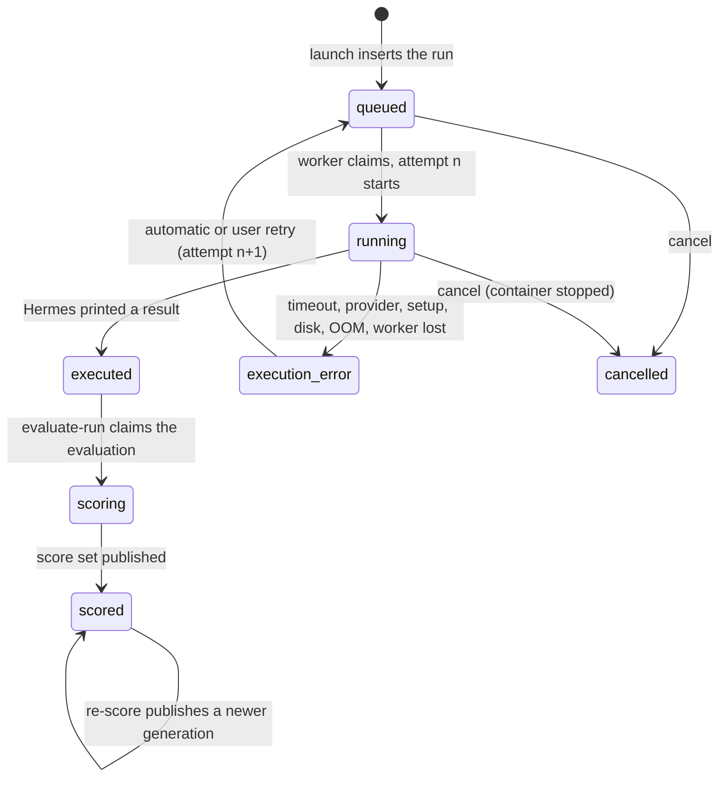

### Attempt

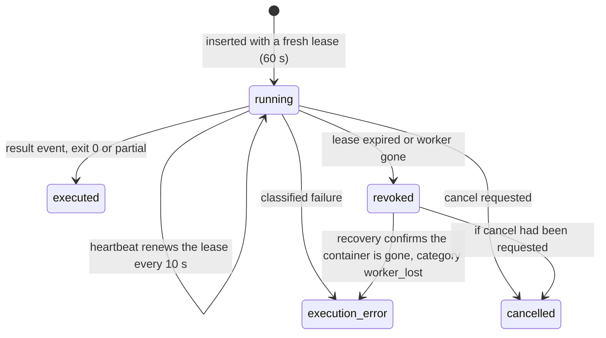

`revoked` is not a status of its own: it is `running` with `lease_revoked_at` set. From there the database allows only `execution_error` or `cancelled`.

### Experiment

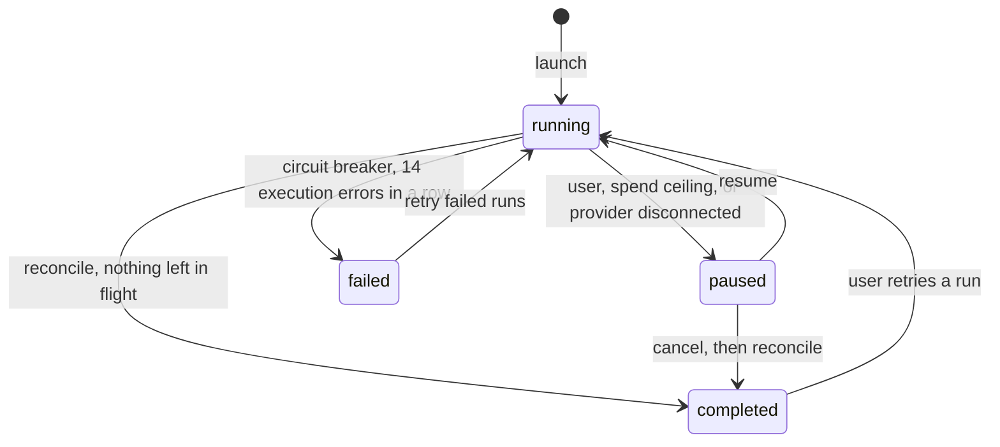

### Evaluation (one scoring pass)

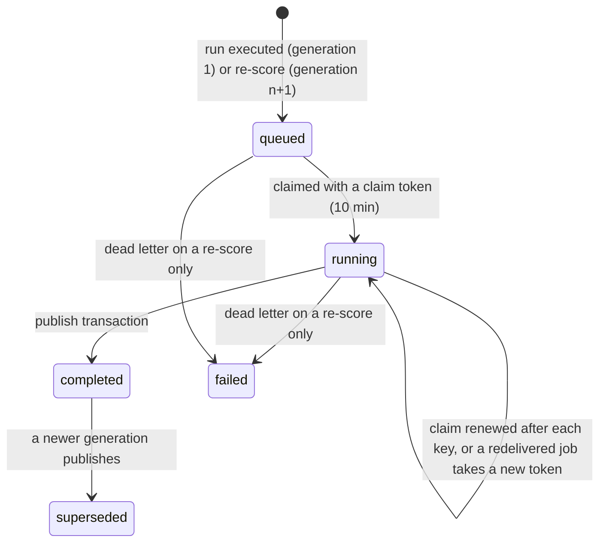

A first evaluation never ends `failed`: when its job dies, the dead-letter handler publishes one `error` score per key, so the run still reaches `scored`. A failed re-score leaves the previous generation current.

### Nous Portal login

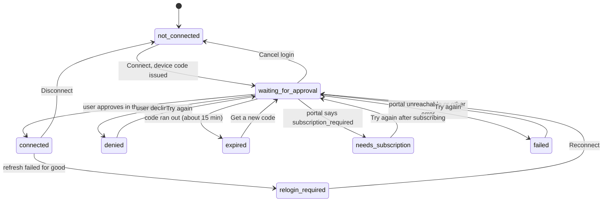

Two more states come from outside this machine: `host` (development, `NOUS_HOST_PROXY` set and the host proxy answering) and `host_unreachable` (set, but not answering). The plan also defines `unavailable` (the login service failed its startup check); the design has no frame for it yet.

---

## 4. App shell: navigation, banners, live pills

Status: **Built** in the web app against fixtures (`AppShell.vue`, providers and system stores). The API serves `/system/summary`, `/system/events` (SSE) and `/providers` (Phase 2). **Planned**: switching the web app to the real API (Phase 5).

What the user sees on every page: a 48 px top bar with Experiments, Suites, Configurations, Resources, then System after a divider with a status dot. On the right are the live pill ("2 running · 87 of 240 scored"), the approval pill while a Nous login is waiting, and the theme toggle. Under the bar, an amber banner when a provider that configurations use is not connected.

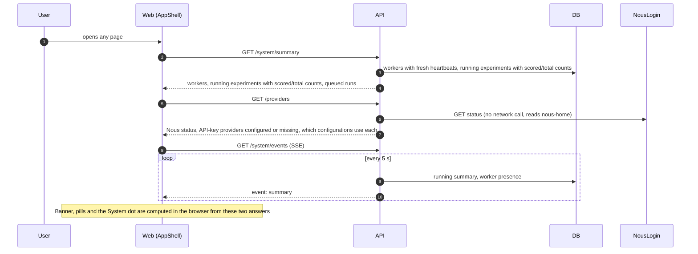

How the shell decides what to show:

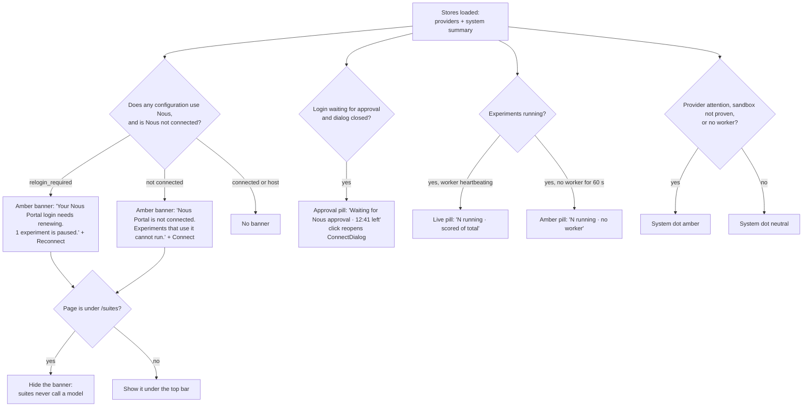

Notes:

- The banner cannot be dismissed while its condition holds. It goes away by itself when the status changes.
- The current web code hides the banner on Suites **and Resources**, following the designer note. The plan exempts only Suites. See open points.
- The theme toggle only changes `data-theme` on the page and remembers the choice in the browser. Nothing goes to the server.

---

## 5. System page

Status: **Built** in the web app against fixtures (rows, checks, workers). The worker's isolation self-test runs at every worker start, and `GET /system/sandbox` and `GET /system/workers` expose it (Phase 1). **Planned**: the page against the real API (Phase 5).

The page has three sections, plus a planned fourth:

- **Model access**: one row per provider.
- **Sandbox**: whether isolation is proven, with the 15 checks.
- **Workers**: one row per worker.
- **Secrets presence** (planned, plan 12.2 item 11).

### 5.1 Worker start and the isolation proof

This happens when the worker starts, not when the user clicks anything. It is what the Sandbox section reports.

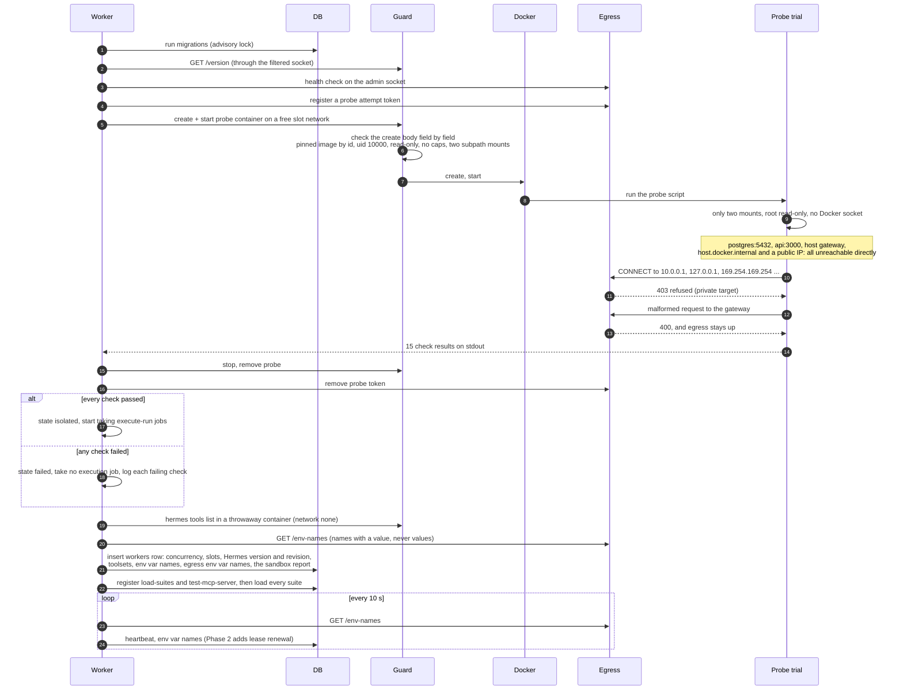

What the user sees: "Isolation proven · 15 of 15 checks · checked 2 min ago at worker start", the Hermes revision and image digest, and a collapsible list of the 15 checks. If a check fails, a red banner names it, and New experiment says that runs cannot start until it passes.

The same checks can be run by hand: `docker compose run --rm --no-deps worker node dist/sandbox-cli.js selftest`.

### 5.2 Workers

`GET /system/summary` (or `/system/workers` in the web data layer) lists `workers` rows with their last heartbeat. A worker is live when its heartbeat is under 60 s old. The row shows concurrency 3, trial slots in use ("2 of 4") and whether its sandbox is proven.

When no worker is live, queued runs simply wait in pg-boss. The UI shows the no-worker banner on running experiments and turns the System dot amber.

### 5.3 Model access rows

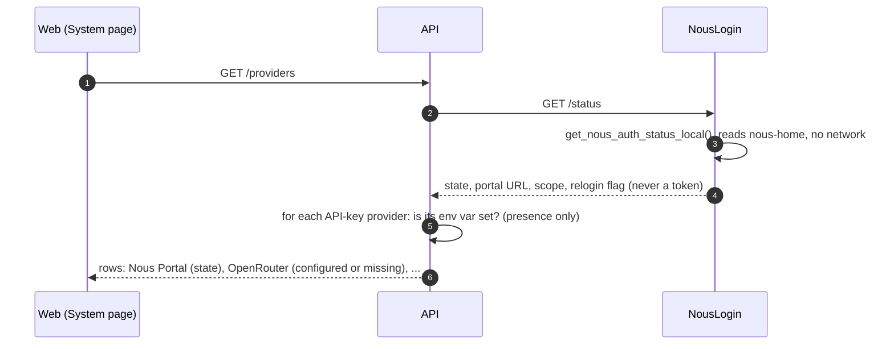

| Row            | States the UI draws                                                                                                                   | Action                                                             |
| -------------- | ------------------------------------------------------------------------------------------------------------------------------------- | ------------------------------------------------------------------ |
| Nous Portal    | not connected, waiting, connected, reconnect, expired, declined, subscription, error, this machine (dev), not running (dev host down) | Connect, Open dialog, Disconnect, Reconnect, Get a new code        |
| OpenRouter etc | configured, missing                                                                                                                   | Copy the `.env` line. No input field: keys never go through the UI |

**Disconnect**: `ConfirmInline` ("Disconnect Nous Portal? Experiments that use it will pause before their next run."), then `POST /providers/nous/logout`. The API calls nous-login, which does what `hermes logout --provider nous` does. Running experiments are not touched directly: the provider guard pauses them at their next claim (section 15).

**Development host login**: with `NOUS_HOST_PROXY` set in `.env`, egress forwards Nous calls to `hermes proxy start` on the host. The row reads "Using this machine's Hermes login (development)" and hides Connect. If the host proxy is down, it shows `not running` with the command to start it.

---

## 6. Connecting Nous Portal

Status: **Built** in the web app against fixtures (dialog, every state, polling, follow-ups), and in the API: the `nous-login` service and the `providers` module (Phase 2), tested against a fake portal. **To run**: a real login approved in the browser (plan spike I14).

Nous Portal has no API keys, only an OAuth device login with rotating refresh tokens. The user connects once from the UI, and the login lives in the `nous-home` volume, never in the database or the browser.

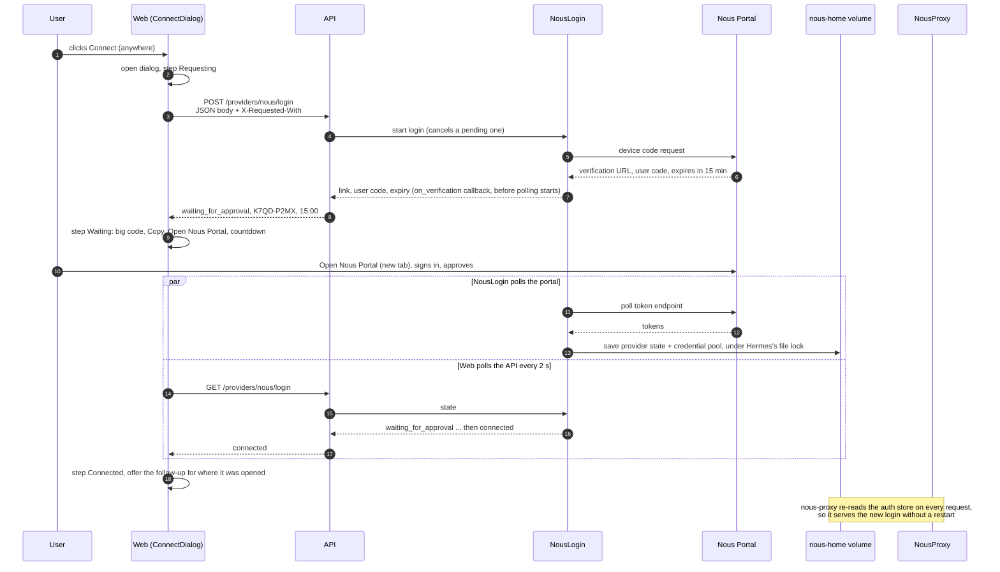

What the dialog offers when it ends depends on where it was opened:

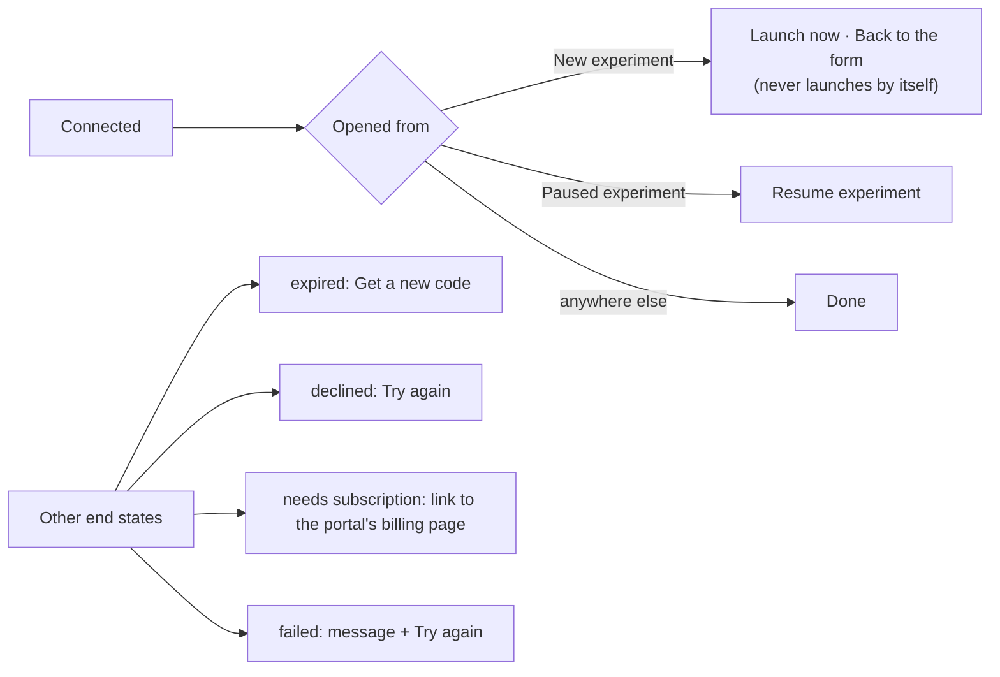

Details that matter:

- **Closing the dialog does not cancel the login.** Polling continues, and the shell shows the approval pill until the login resolves. Polling pauses while the browser tab is hidden and resumes when it is visible again.
- **Cancel login** sends `DELETE /providers/nous/login`.
- **One login at a time.** A second Connect cancels the pending one and starts a new code.
- **Nothing secret leaves the volume.** The API only ever sees the link, user code, state, expiry and non-secret details.
- **CSRF guard.** The API has no authentication, by requirement. The three state-changing calls therefore require `content-type: application/json` and `X-Requested-With`. Another site open in the same browser cannot send those without a CORS preflight, which the API refuses.

---

## 7. Nudges: where the UI blocks model work and why

Status: **Built** in the web app against fixtures (SetupCard, banner, ProviderNotice, BlockedReason, summary blocker), and in the API: the launch 409s and the worker's provider guard (Phase 2), and the 409s of launch and re-score when the LLM judge's provider is not ready (Phase 3). **Planned**: the components against the real API (Phase 5).

The rule: a user should never find out at launch, or halfway through an experiment, that no model is reachable. Every place that leads to a model call checks the providers of the configurations involved.

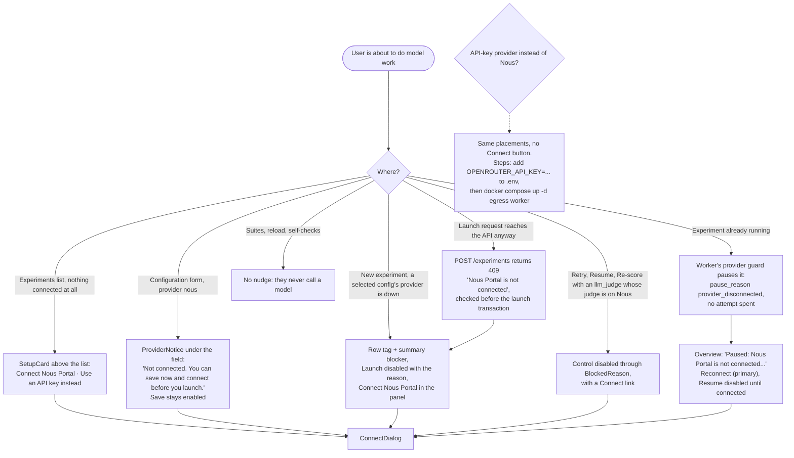

---

## 8. Suites and tasks

Status: **Built** (Phase 1): the file format, the loader in the worker with self-checks and version numbering, the suites endpoints and version history, and the first `invoices-v1` task (`total_due`). **Planned**: the remaining sample tasks (Phase 6), the pages against the real API (Phase 5), and authoring in the UI (Phase 5b).

Suites are folders under `./suites`, edited on disk with any editor. It shows what was loaded, whether every task passes its own self-check, and every version. Phase 5b adds creating and editing suites in the UI: edits go into a draft, and saving writes the same files and loads them as a reload does (plan section 4.6). Its flows are added here when that phase is built.

### 8.1 Reload from disk

The user clicks **Reload all from disk** on the suite list, or **Reload from disk** on one suite. The loader runs in the **worker**, because self-checks run the suite's own verifier scripts (built in Phase 1, decision D1). The API sends a `load-suites` job and waits for its result. The worker also loads every suite when it starts.

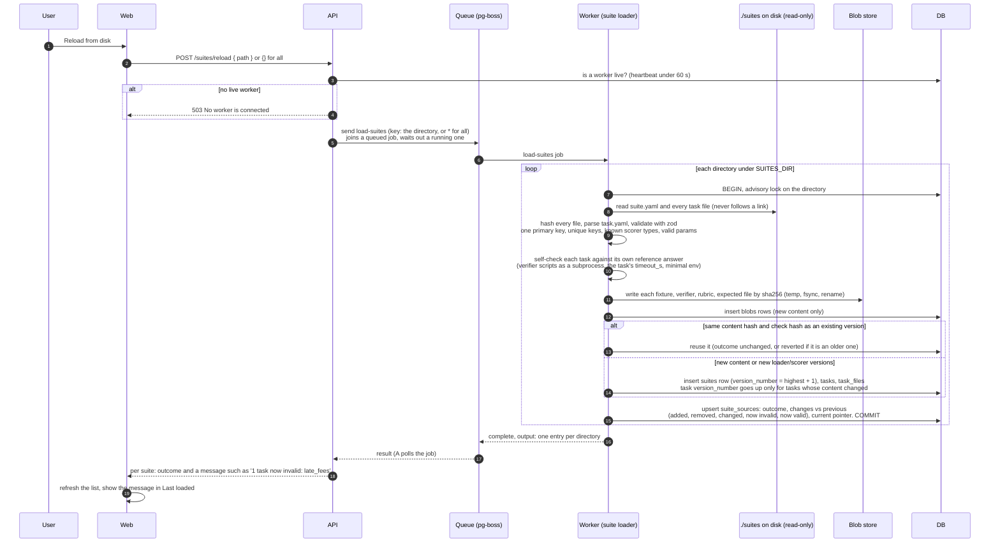

What can happen on a reload:

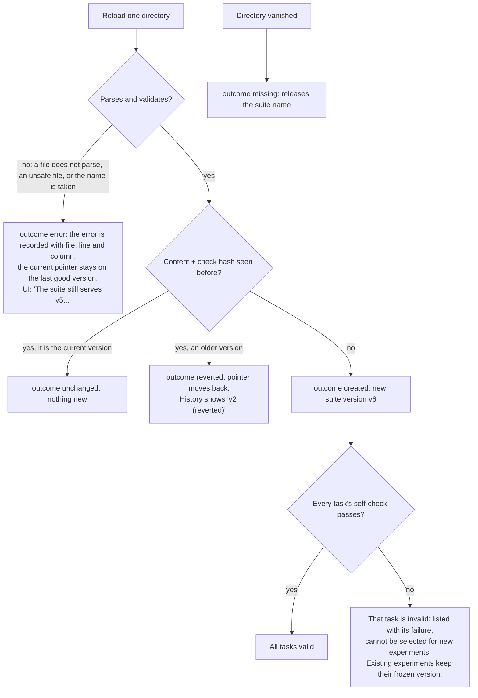

After a load, **nothing reads `./suites` again**. Trials, verifiers, judges and the fixture endpoint read blobs by hash. So an edit on disk can never change an experiment that already exists.

### 8.2 Browsing suites and tasks

| User action                           | Call                                               | What the API reads                                                                                                                  |
| ------------------------------------- | -------------------------------------------------- | ----------------------------------------------------------------------------------------------------------------------------------- |
| Open Suites                           | `GET /suites`                                      | `suite_sources` with the current `suites` row: name, v5, label 0.3, task and valid counts, last change                              |
| Open a suite                          | `GET /suites/:id`                                  | that suite version's tasks with validity and self-check failures                                                                    |
| Pick an older version in the selector | `GET /suites/:olderId`                             | the same, for that version, read-only notice                                                                                        |
| History panel                         | `GET /suites/:id/history`                          | every version of the directory, its changes, and the experiments that used each                                                     |
| Expand a failed self-check            | (already in the suite payload)                     | verifier output, the contract, what changed                                                                                         |
| Open a task                           | `GET /suites/:id/tasks/:key`                       | prompt, fixtures with hashes, verification entries, hidden reference, verifier source, self-check, limits, experiments that used it |
| Task History                          | `GET /suites/:id/tasks/:key/history`               | the task key's versions and where each first appeared                                                                               |
| Open a diff                           | `GET /suites/:id/tasks/:key/diff?against=:suiteId` | prompt and task.yaml text diffs, reference JSON diff, file list changes                                                             |
| Preview or download a fixture         | `GET /suites/:id/tasks/:key/fixtures/:path`        | the blob by hash                                                                                                                    |

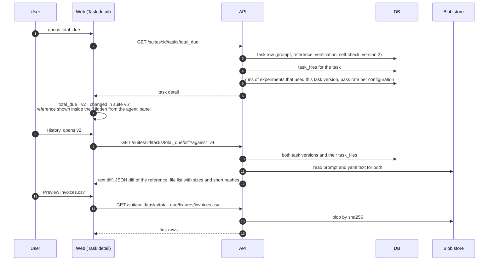

The reference answer is shown to the user (it is their own task) but marked "Hidden from the agent": it is never copied into a trial. Only task files of kind `fixture` ever enter a workspace.

---

## 9. Resources: skills, documents, MCP servers, secrets

Status: **Built**: the tables, every endpoint and the MCP test handler (Phase 1); the http branch of Test start through the egress MCP gateway (Phase 2). **Planned**: the pages against the real API (Phase 5).

Resources are the building blocks configurations point at. Every resource version is immutable once a configuration uses it.

### 9.1 Upload a skill (two steps)

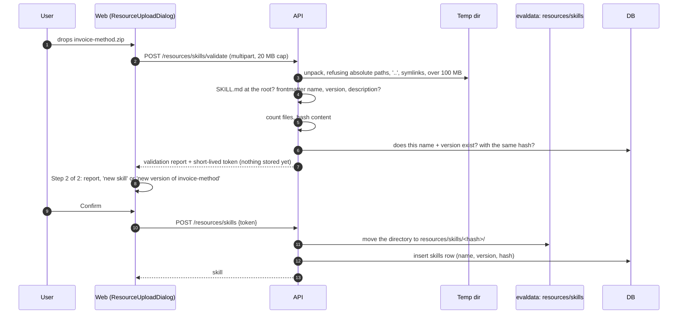

Refusals the dialog shows: no `SKILL.md` at the root, missing frontmatter fields, an unsafe path, too large, and "same name and version, different content" (the user must bump the version).

Skill detail (`GET /resources/skills/:id/files/:path`, `GET /resources/skills/:id/zip`) shows the files and which configurations use it.

### 9.2 Upload a document

`POST /resources/documents` (50 MB cap) stores the content in the blob store by sha256 and inserts a `documents` row. Documents attach to configurations only. At run time they are copied into the workspace under `docs/`, and the artifact list later marks them unchanged or modified.

### 9.3 Define and test an MCP server

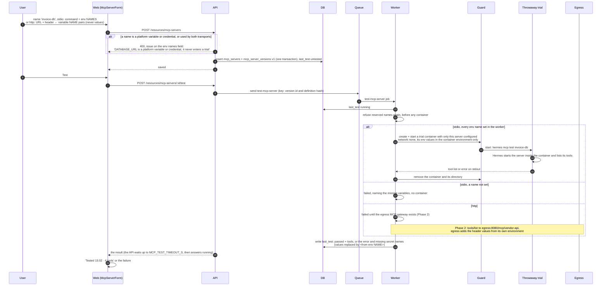

Editing rules:

- **Edit a definition no configuration version uses**: updated in place.
- **Edit one that is frozen** (a configuration version uses it): `PUT` creates version 2. The form warns: configurations on version 1 keep it.
- **Save without testing** is allowed. The version then shows `untested`.

The form says, per transport, what the agent can read. Under a stdio server's environment variables, an amber caution: "This server runs inside each run's container. The agent can read these values. Use scoped or throwaway values." Under an http server's header names: "Egress adds these headers to each request on the way to the server. The run never sees their values." Section 9.4 explains why.

### 9.4 Secrets

Status: **Built**: the endpoint and presence reporting (Phase 1), and the egress MCP gateway that adds header values (Phase 2, spike I15 passed). **Planned**: the pages against the real API (Phase 5).

`GET /resources/secrets` lists every name that MCP definitions reference: set or not set, its source, what references it, its exposure, and when it was last checked. Values are never shown, stored, typed or sent to the browser. A value is set by adding it to `.env` and restarting the service that reads it (`docker compose up -d egress worker`).

How a value reaches a run depends on the server's transport:

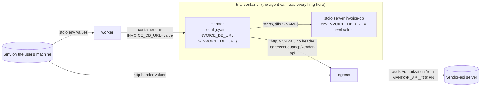

| Case                | The value lives in                                             | Readable by the agent? | UI label                             |
| ------------------- | -------------------------------------------------------------- | ---------------------- | ------------------------------------ |
| stdio, env variable | the trial's container environment and the server process's env | Yes                    | "Readable by the agent" (amber)      |
| http, header        | egress only; added to each request on the way to the server    | No                     | "Added by egress · never in the run" |

- **Why stdio is readable.** A stdio server is a process inside the trial, and it needs the real value to work. The agent has a terminal in the same container, so it can read `/proc/<pid>/environ` or start the same command itself. A placeholder cannot help. The UI states it as a fact in the caution style, never the failure colour, and never blocks saving: Resources › Secrets (Exposure column), the MCP form, the configuration form and detail beside the server, System › Secrets, and the run's launch record.
- **Never in a file.** `config.yaml` in the home holds `${INVOICE_DB_URL}`, which Hermes fills from its own environment when it starts the server. Launch records, stored `config.yaml` copies and stderr tails show `<from env INVOICE_DB_URL>`.
- **stdio servers have no network.** Hermes starts them with a filtered environment that drops the proxy variables, and the slot network has no other route. A server that must reach a remote service is defined as http.
- **Presence.** The worker records the names it has on its `workers` row at start, and asks egress over its admin socket which names egress has. "Check again" re-reads them. A run or a test with a missing name ends as `execution_error · setup` and names it.

---

## 10. Configurations

Status: **Built**: tables, versioning triggers (a frozen version never changes), the config hash, and every endpoint (Phase 1). **Planned**: the pages against the real API (Phase 5).

A configuration is a record of how Hermes is set up: model, provider, toolsets, memory, skills, documents, MCP servers and limits. It is only a definition: saving one never calls a model, so Save is never blocked by provider status.

### 10.1 Create, edit, duplicate

```mermaid
sequenceDiagram
  autonumber
  participant U as User
  participant W as Web (ConfigurationForm)
  participant A as API
  participant DB as DB

  W->>A: GET /configurations/form-options (models with prices, providers,<br/>toolsets the live worker found in the trial image, skills, documents, MCP versions)
  W->>A: GET /providers (for the ProviderNotice under the provider field)
  U->>W: fills name, model, provider, toolsets, memory, skills, documents, MCP servers, limits
  W->>W: unknown model? warn 'no price: cost will show as —'
  U->>W: Save
  alt new configuration
    W->>A: POST /configurations
    A->>DB: insert configurations + configuration_versions v1 (config hash)<br/>freeze the MCP definitions it uses
  else editing
    W->>A: PUT /configurations/:id
    A->>DB: lock the latest version
    alt version is frozen (an experiment used it)
      A->>DB: insert version n+1, move the latest pointer
    else not frozen
      A->>DB: update it in place, recompute config hash
    end
  end
  A-->>W: saved version
```

The form shows the versioning rule before saving: on a configuration an experiment already used, the banner reads that saving creates version 2 and that the experiments keep version 1. The button reads **Save as version 2**.

**Duplicate** (`POST /configurations/:id/duplicate`) returns a prefilled draft. No row exists until the user saves.

### 10.2 List, compare, detail

| User action                  | Call                                      | Result                                                                                            |
| ---------------------------- | ----------------------------------------- | ------------------------------------------------------------------------------------------------- |
| Open Configurations          | `GET /configurations`                     | name, latest version, model, provider, skill/doc/MCP counts, used in N experiments                |
| Select two or three, Compare | `GET /configurations/diff?versions=a,b,c` | one row per field with each value and a `differs` flag; same rows feed ConfigDiffTable everywhere |
| Open one                     | `GET /configurations/:id`                 | fields, every version, duplicated-from, used in which experiments                                 |
| Open an older version        | `GET /configurations/:id/versions/:v`     | that version's fields, read-only                                                                  |

### 10.3 What a configuration becomes at run time

A configuration version is turned into the trial's `config.yaml` and command line (section 12.2): model and provider pointed at the egress gateway, toolsets plus one `-t` entry per MCP server name, `-s` per skill, memory on or off, max turns and time budget. The platform adds the rest itself so arms differ only where the user intended: bundled Hermes skills off, update checks off, approvals off.

Hermes always installs its own `hermes-agent` skill in every home and it cannot be turned off. So `baseline` has "no added skills", not "no skills": every arm has that one skill.

---

## 11. New experiment and launch

Status: **Built**: tables, the launch trigger, transactional job sending, and the endpoints: `GET /experiments/new-options`, the estimate and `POST /experiments` with its 409 checks (Phase 2). **Planned**: the page against the real API (Phase 5).

### 11.1 Filling the form

```mermaid
sequenceDiagram
  autonumber
  participant U as User
  participant W as Web (NewExperiment)
  participant A as API
  participant DB as DB

  W->>A: GET suites with valid tasks, configurations with latest versions and config hashes
  W->>A: GET /providers
  U->>W: picks suite invoices-v1 v5, tasks (invalid ones disabled with the reason)
  U->>W: picks baseline + candidate(s)
  W->>A: GET /configurations/diff?versions=baseline,candidate
  A-->>W: differing fields, shown inline (with-skill differs in 1 field: skills)
  U->>W: repetitions 5, concurrency 3, spend ceiling, time budget override
  W->>A: GET /experiments/estimate?suite=&versions=&repetitions=&concurrency=
  A->>DB: median duration and cost of past attempts on this suite and config_hash
  A-->>W: 120 runs, 40 waves, about 36 min, $1.69 (or basis budget when no history)
  W->>W: ExperimentSummaryPanel: runs, time, cost, blockers
```

The summary panel decides whether **Launch** is enabled:

```mermaid
flowchart TD
  F["Form state"] --> V{"Name, suite, at least one task,<br/>baseline + at least one candidate?"}
  V -- no --> D1["Launch disabled: the missing field"]
  V -- yes --> PR{"Every selected configuration's provider connected?"}
  PR -- no --> D2["Launch disabled: 'Nous Portal is not connected'<br/>+ Connect Nous Portal in the panel"]
  PR -- yes --> SB{"Sandbox proven and a worker live?"}
  SB -- no --> D3["Launch disabled: runs cannot start until the sandbox passes"]
  SB -- yes --> SP{"Estimate over the spend ceiling?"}
  SP -- yes --> WARN["Warning, Launch still allowed:<br/>the spend guard will pause at the ceiling"]
  SP -- no --> OK["Launch enabled"]
  WARN --> OK
```

### 11.2 Launch: one transaction

```mermaid
sequenceDiagram
  autonumber
  participant U as User
  participant W as Web
  participant A as API
  participant NL as NousLogin
  participant DB as DB
  participant Q as Queue (pg-boss, same DB)

  U->>W: Launch
  W->>A: POST /experiments {name, suite_id, task_ids, baseline, candidates,<br/>repetitions, concurrency, spend_ceiling, expected_config_hashes}
  A->>NL: is Nous connected? (and key providers set?)
  alt a provider is not connected
    A-->>W: 409 'Nous Portal is not connected'
  end
  A->>DB: BEGIN
  A->>DB: freeze baseline + candidate versions (UPDATE ... SET frozen_at = now() WHERE frozen_at IS NULL)
  A->>DB: SELECT config_hash FOR SHARE, compare with expected_config_hashes
  alt a configuration changed since the form loaded
    A->>DB: ROLLBACK
    A-->>W: 409 listing the changed configurations
  end
  A->>DB: Hermes version + revision from live workers (409 if none or they disagree)
  A->>DB: snapshot the price table
  A->>DB: INSERT experiment (launch trigger: frozen versions, valid tasks of this suite version)
  A->>DB: INSERT tasks x versions x repetitions runs, all queued (12 x 2 x 5 = 120)
  A->>Q: send one execute-run job per run, key runId:1, trigger initial
  A->>DB: COMMIT (rows and jobs together, or nothing)
  A-->>W: experiment id
  W->>W: go to the Overview tab, open the SSE stream
```

If the response is a 409, the form keeps everything entered and shows the reason where the panel's error sits ("Launch refused… POST /api/experiments → 409").

### 11.3 Duplicate, and running on a newer suite version

Experiments never change: they stay pinned to the suite version they ran. To run on edited tasks, the user duplicates.

```mermaid
sequenceDiagram
  autonumber
  participant U as User
  participant W as Web
  participant A as API
  participant DB as DB

  W->>A: GET /experiments/:id (completed, ran on invoices-v1 v4)
  A->>DB: experiment + its suite + suite_sources current pointer
  A-->>W: suite v4, newer version v5 exists, 1 task changed (total_due)
  W->>W: snapshot strip notice: 'A newer version of invoices-v1 exists (v5)...' + Duplicate on v5
  U->>W: Duplicate on v5
  W->>A: POST /experiments/:id/duplicate
  A->>DB: map each task key to the current version: same, changed, removed, now invalid
  A-->>W: prefilled draft on v5 + the differences
  W->>W: New experiment form with the notice:<br/>'Duplicated from Skill vs no skill (suite v4). Now using v5. Changed since then: total_due...'<br/>removed or invalid tasks listed and left out with their reason
  U->>W: Launch (section 11.2)
```

---

## 12. What happens to one run: execution

Status: **Built and proven live** (Phase 2): the `execute-run` handler around the trial runner (claim, admission, leases and heartbeat, the cancel watcher, event batching into `run_events`, artifact collection, recovery), run on the Compose stack with real Hermes and the scripted mock model (`docs/phases/phase-2.md` section 6).

The user sees none of this directly. They see a run go `queued → running → executed`, its events stream into the inspector, and the counters move. This section is what happens underneath.

### 12.1 Claim and admission

```mermaid
sequenceDiagram
  autonumber
  participant Q as Queue
  participant WK as Worker
  participant DB as DB
  participant NL as NousLogin

  Q->>WK: execute-run {runId, attempt n, trigger}, singleton key runId:n
  WK->>DB: BEGIN, lock the experiment row
  alt experiment paused, failed or cancelled
    WK->>Q: complete the job, do nothing (resume re-sends it)
  end
  WK->>DB: lock the run
  alt run not queued, or attempt_count is not n-1
    WK->>Q: stale or duplicate job: complete it, do nothing
  end
  WK->>DB: count this experiment's running runs
  alt at or above the experiment's concurrency
    WK->>Q: deferJob: complete this job + send a copy starting in 5 to 15 s (one transaction)
  end
  WK->>DB: sum priced attempt costs (spend guard)
  alt at or above the spend ceiling
    WK->>DB: pause experiment, pause_reason spend_ceiling
  end
  WK->>NL: provider guard: is the configuration's provider connected? (no network call)
  alt not connected
    WK->>Q: deferJob, no attempt spent
    WK->>DB: pause experiment, pause_reason provider_disconnected
  end
  WK->>DB: INSERT attempt n: running, lease_token, lease_expires_at now+60 s, sandbox host
  WK->>DB: UPDATE run: running, current attempt
  WK->>DB: COMMIT
```

From here on, every write to the attempt is fenced: `WHERE id = $a AND lease_token = $t AND status = 'running' AND lease_revoked_at IS NULL`. Zero rows means the lease is lost: stop the container and give up.

### 12.2 The trial

```mermaid
sequenceDiagram
  autonumber
  participant WK as Worker
  participant V as Trials volume
  participant E as Egress
  participant G as Guard
  participant T as Trial (Hermes)
  participant P as Provider (via egress)
  participant DB as DB

  WK->>V: create trials/<attempt>/home and /workspace (fresh, lstat-checked)
  WK->>V: copy fixtures (hash re-checked) to workspace, documents to workspace/docs
  WK->>V: copy skills to home/skills/<name>, write home/.no-bundled-skills
  WK->>V: write home/task.txt (the prompt) and home/config.yaml<br/>(no key · stdio MCP env as ${NAME} · http MCP url = egress:8080/mcp/<name>)
  WK->>DB: write the launch record: argv, container spec, config.yaml, inputs + hashes, Hermes revision
  WK->>E: register attempt: token, provider, model, max tokens, expiry,<br/>http MCP routes, public mode if web toolsets
  WK->>G: POST /containers/create (trial spec, plus stdio MCP env values)
  G->>G: validate every field, pin the image by id
  WK->>G: start, then wait (registered before start)
  Note over WK: stop conditions armed now, before reading output:<br/>deadline (budget + grace), cancel, disk watchdog (2 GiB / 50,000 files, polled each second)
  WK->>G: follow logs (stdout, stderr)
  loop the agent works
    T->>E: model call with the attempt token (OpenAI-compatible)
    E->>E: token valid? model allowed? token budget left?
    E->>P: forward with the real credential (or to nous-proxy)
    P-->>E: completion (usage counted for this attempt)
    E-->>T: completion
    T->>T: tool calls run inside the container (terminal, file, MCP stdio)
    opt http MCP tool call
      T->>E: POST egress:8080/mcp/<name> with the attempt token
      E->>E: add the definition's headers, forward to its exact URL, log the call
    end
    T-->>WK: stream-json lines on stdout
    WK->>DB: run_events in batches of 50 or every 500 ms, gap-free seq (fenced on the lease)
    WK->>DB: heartbeat every 10 s renews the lease
  end
  T-->>WK: result event (final text, tokens), container exits
  WK->>G: remove the container
  WK->>E: remove the attempt: token dies, returns usage + connection log
  WK->>DB: connection log rows as platform events (allowed, refused, Hermes background call)
  WK->>V: walk workspace with lstat, never follow links, read with O_NOFOLLOW
  WK->>DB: blobs for new files, artifacts rows labelled fixture/document unchanged or modified, or agent
  WK->>DB: BEGIN: final platform events, finish the attempt (classified)
  WK->>DB: if executed: run executed, INSERT evaluation generation 1, send evaluate-run
  WK->>DB: COMMIT
  WK->>V: delete home, keep workspace for TRIAL_RETENTION_DAYS
```

Why each piece is there:

- **A container per trial.** Hermes runs its agent loop in a detached gateway daemon, so killing a process does not stop a run, and it can read any absolute path. A container bounds its files, network and processes, and stopping it ends everything.
- **The attempt token.** The trial never holds a provider credential. It holds a token that is valid only from its slot network, for one model, until the attempt ends. The only secrets it holds are its stdio MCP servers' env values (section 9.4).
- **The safe reader.** The agent controls every file name, link and file type in its workspace. The worker never follows a link and never opens a FIFO or device.
- **The answer** is always the `result` event's text, never the streamed pieces joined back together: Hermes can drop a newline-only delta.

### 12.3 How the attempt ends

```mermaid
flowchart TD
  X["Container exited or was stopped"] --> R{"result event?"}
  R -- "exit 0, text" --> EX["executed"]
  R -- "exit 1, partial (max turns)" --> EX
  R -- "error: auth, 401, 403, 429, 5xx, connection" --> PV["execution_error · provider"]
  R -- none --> W{"Why did it stop?"}
  W -- "deadline: SIGTERM, SIGKILL after 10 s" --> TO["execution_error · timeout<br/>(platform result event synthesised)"]
  W -- "cancel requested" --> CA["cancelled"]
  W -- "disk cap passed" --> DK["execution_error · other (names the cap)"]
  W -- "OOM killed" --> OM["execution_error · other"]
  W -- "failed to start, Hermes failed before init,<br/>MCP server failed, exit 3 'input required'" --> SE["execution_error · setup"]
  W -- "anything else" --> OT["execution_error · other"]

  EX --> EV["run executed, evaluation queued (section 13)"]
  PV --> AR{"First attempt?"}
  TO --> AR
  AR -- yes --> RQ["automatic retry: attempt 2, 30 s later"]
  AR -- no --> FE["run stays execution_error, user may retry (up to 5 attempts)"]
  SE --> FE
  DK --> FE
  OM --> FE
  OT --> FE
  CA --> RC["reconcile"]
  FE --> CB["consecutive_execution_errors + 1<br/>at 14 the experiment fails (circuit breaker)"]
  FE --> RC
```

### 12.4 Recovery: a worker dies mid-run

```mermaid
sequenceDiagram
  autonumber
  participant WK2 as Any live worker
  participant DB as DB
  participant G as Guard
  participant Q as Queue

  loop at boot and every 15 s (one pass at a time, advisory lock)
    WK2->>DB: revoke leases that expired, whose worker stopped,<br/>or past deadline + 120 s
    WK2->>G: list containers labelled with that attempt (same Docker daemon only)
    WK2->>G: stop, wait, confirm not running, remove, list again until empty
    WK2->>DB: BEGIN (experiment, run, attempt locks)
    WK2->>DB: attempt execution_error · worker_lost (or cancelled if cancel was requested)
    WK2->>DB: requeue the run with the next attempt if under 3 recovery attempts
    WK2->>Q: send execute-run runId:n+1
    WK2->>DB: reconcile, COMMIT
    WK2->>G: sweep: remove trial containers whose attempt is not running
    WK2->>Q: re-send execute-run for queued runs and evaluate-run for expired claims<br/>(exclusive keys make these no-ops when the job exists)
  end
```

A missing heartbeat alone never proves the trial stopped. A replacement starts only after a worker on the same Docker daemon has confirmed the old container is gone.

---

## 13. What happens to one run: scoring

Status: **Built**: answer extraction, the `numeric_tolerance`, `json_match`, `exact_match`, `file_check` and `verifier_script` scorers (Phase 1); the `evaluate-run` handler with claim, publish and the dead letter (Phase 2); `text_match`, `trajectory_match`, `llm_judge` with its judge path through egress, the claim renewed after each key, and re-score (Phase 3; `docs/phases/phase-3.md`). **Planned**: verdict entries (Phase 4).

Scoring is separate from execution, so a scorer bug is fixed by re-scoring. Hermes is never run again for it.

```mermaid
sequenceDiagram
  autonumber
  participant Q as Queue
  participant WK as Worker
  participant DB as DB
  participant B as Blob store
  participant E as Egress admin socket
  participant J as Judge model (via its provider)

  Q->>WK: evaluate-run {evaluationId}
  WK->>DB: claim: UPDATE evaluations SET running, new claim_token, expires in 10 min<br/>WHERE status queued or running
  alt zero rows
    WK->>Q: already finished: complete the job
  end
  WK->>DB: read attempt final_text, the task's prompt, reference and verification list,<br/>artifacts, rubric files, the experiment's frozen prices
  WK->>WK: extract the answer: last fenced json block, parse, keep start/end offsets
  loop each verification key of the task
    alt numeric_tolerance, json_match, exact_match
      WK->>WK: compare the answer (at its path) with the reference
    else text_match
      WK->>WK: look for the phrases and the pattern in the answer (at its path), 1 s per match
    else trajectory_match
      WK->>DB: tool_use/tool_result events: count the matching calls, or match the trajectory
    else file_check
      WK->>B: read the artifact by hash, check format, columns, rows, schema
    else verifier_script
      WK->>B: materialise verifier files + artifacts into a temp dir
      WK->>WK: python3 verify/check.py --answer tmp.json --workspace dir (30 s, outside any trial)
    else llm_judge
      WK->>E: register one judge call (the judge model only, minutes), then the chat completion
      E->>J: rubric, task and reference as facts, agent text as untrusted data,<br/>temperature 0, at most 1,024 tokens, egress's credential added
      J-->>E: score 0 to 1 and a comment
      E-->>WK: the answer and the tokens egress metered, then the registration is removed
    end
    WK->>DB: renew the claim (10 min again) while the token still matches, otherwise stop and drop the work
  end
  WK->>DB: BEGIN, lock experiment then run
  WK->>DB: re-read the evaluation FOR UPDATE with the claim token (zero rows: someone newer owns it, roll back)
  WK->>DB: insert every score, supersede the previous evaluation, complete this one
  WK->>DB: run scored, results_revision goes up (trigger)
  WK->>DB: reconcile the experiment
  WK->>DB: COMMIT
```

The judge is the platform's, not the run's: a check's own `model:`, else `JUDGE_MODEL`, on `JUDGE_PROVIDER` (`nous` when unset). With no judge model the key is `error`, never a zero. Its tokens and cost are stored in the score's evidence as grading cost, outside the spend guard.

What each outcome means, kept apart everywhere in the UI:

| Status            | Meaning                                            | Example                                    |
| ----------------- | -------------------------------------------------- | ------------------------------------------ |
| `passed`          | the agent was right                                | total within ±0.01                         |
| `failed`          | the agent was wrong                                | total off by 1,500                         |
| `ungradable`      | nothing could be extracted                         | no fenced JSON block in the final response |
| `error`           | the check itself broke                             | verifier printed no result line            |
| `execution_error` | (a run status, not a score) no answer was produced | timeout, provider down                     |

**Re-score** (`POST /runs/:id/rescore`, or the bulk bar): inserts an evaluation with the next generation and sends `evaluate-run`, in one transaction. Only a `scored` run can be re-scored (409 "run is …, not scored"), and a task with an `llm_judge` key needs the judge's provider ready (409 "Re-score needs Nous Portal for the method judge: …"). The run stays `scored`, and its previous result stays current, until the new generation publishes; the inspector and the Runs tab show the pending re-score. Only one evaluation per run can be queued or running, so double clicks collapse: a second request answers the pending one (`joinedPending`). A re-score grades the experiment's frozen task with the scorers as they are now in code, and the judge settings of the moment. If the experiment was completed, publishing raises the results revision; from Phase 4, reconcile also appends a verdict with cause `rescore`.

**When a scoring job dies for good**: for a first evaluation, one `error` score per key is published, so the run still reaches `scored`. A failed re-score leaves the previous result current.

### 13.1 Reconcile: when is an experiment done?

```mermaid
flowchart TD
  T["Any transaction that finishes a run:<br/>scores published, final execution error,<br/>cancellation, recovery, or the 15 s safety pass"] --> L["Lock the experiment row"]
  L --> S{"Any run queued, running, executed or scoring,<br/>or any evaluation queued or running?"}
  S -- yes --> STOP["Not settled: return"]
  S -- no --> V["Compute verdict entries from current scores"]
  V --> U{"verdict_revision different from results_revision?"}
  U -- no --> SAME["Already recorded: return"]
  U -- yes --> C["status completed, finished_at,<br/>append to verdict_history (cause initial, retry or rescore),<br/>verdict_revision = results_revision"]
```

Two workers finishing the last two runs at the same moment append the verdict once: the conditional update lets only one through. As built, reconcile completes the experiment and sets `verdict_revision`, but computes and appends no verdict entry until Phase 4.

---

## 14. Experiment list and overview, live

Status: **Built** in the web app against fixtures, and in the API: the list, the detail and the SSE stream (Phase 2). **Planned**: verdict entries (Phase 4) and the pages against the real API (Phase 5).

### 14.1 Experiment list

`GET /experiments` returns one row per experiment, newest first: name, status chip, suite and version, configurations, runs done of total, cost, and the verdict chip once complete. A failed experiment shows its failure reason in the row. Clicking a row opens the Overview tab.

### 14.2 Overview while running

```mermaid
sequenceDiagram
  autonumber
  participant U as User
  participant W as Web (Overview)
  participant A as API
  participant DB as DB

  U->>W: opens an experiment
  W->>A: GET /experiments/:id
  A->>DB: experiment, frozen snapshot (suite version, configurations, Hermes revision, prices),<br/>run counts by status, per-configuration progress, spend, last 10 events, verdicts
  A-->>W: header, snapshot strip, progress breakdown, feed
  W->>A: GET /experiments/:id/events (SSE)
  loop shared poller per experiment, every 1 s
    A->>DB: run status changes, scores landed, counts, experiment status since last poll
    A-->>W: events
    W->>W: patch records in place (rows never reorder while live)
  end
  Note over W,A: connection lost: reconnect after 1, 2, 5, 10 s.<br/>LiveIndicator shows reconnecting, then offline with Retry
```

What the overview shows, and where each number comes from:

| On screen                                            | Source                                                                                        |
| ---------------------------------------------------- | --------------------------------------------------------------------------------------------- |
| "87 of 120 scored · 28 queued · 3 running · 1 error" | run counts by status                                                                          |
| Per-configuration bars, provisional pass rate        | passed / scored per configuration so far                                                      |
| Spend "$0.71 of $2.00 ceiling · projected $1.69"     | sum of priced attempt costs, estimate for the rest                                            |
| Feed                                                 | the last 10 run transitions and scores                                                        |
| Snapshot strip                                       | what the experiment froze at launch: suite + version, configuration versions, Hermes revision |
| VerdictCard (complete)                               | the latest `verdict_history` entry, with "Updated … · previously …" when it changed           |
| No-worker banner                                     | no worker heartbeat for 60 s while runs are queued                                            |
| Paused banners                                       | `pause_reason`: user, spend_ceiling, provider_disconnected                                    |
| Failed banner                                        | the circuit breaker's structured failure: category, message, first stderr line, attempt       |

---

## 15. Experiment controls

Status: **Built**: the endpoints and their guards (pause, resume, cancel, retry failed, duplicate, the spend guard and the circuit breaker; Phase 2). **Planned**: the buttons against the real API (Phase 5).

Every control is one transaction that locks the experiment row first.

```mermaid
flowchart TD
  subgraph user["User actions"]
    PA["Pause"]
    RE["Resume"]
    CN["Cancel (ConfirmInline)"]
    RF["Retry failed runs<br/>(failed experiment)"]
    RR["Retry a run<br/>(inspector or bulk)"]
    DU["Duplicate"]
  end

  PA --> PA1["status paused, pause_reason user.<br/>Workers that claim its jobs complete them without starting anything.<br/>In-flight trials finish."]
  RE --> RE0{"Paused for the spend ceiling?"}
  RE0 -- yes --> RE1["needs a higher ceiling"]
  RE0 -- "provider_disconnected" --> RE2["needs the provider connected<br/>(else disabled through BlockedReason)"]
  RE0 -- user --> RE3["status running"]
  RE1 --> RE3
  RE2 --> RE3
  RE3 --> RE4["send execute-run for every queued run,<br/>key runId:attempt_count+1 (no-op if still waiting)"]
  CN --> CN1["cancelled_at set. Queued runs cancelled, their jobs cancelled.<br/>Running runs get cancel_requested_at:<br/>the owning worker stops the container, attempt cancelled.<br/>Executed and scoring runs finish scoring.<br/>Reconcile completes it when nothing is in flight."]
  RF --> RF1["status running, failure cleared,<br/>queued runs re-sent like resume"]
  RR --> RR1{"execution_error and fewer than 5 attempts?"}
  RR1 -- yes --> RR2["run queued, execute-run with the next attempt.<br/>A completed experiment goes back to running."]
  RR1 -- no --> RR3["refused with the reason"]
  DU --> DU1["prefilled New experiment on the suite's current version (section 11.3)"]
```

The two automatic guards, which the user only sees as a paused experiment:

```mermaid
sequenceDiagram
  autonumber
  participant WK as Worker (claim)
  participant DB as DB
  participant NL as NousLogin
  participant W as Web (Overview)
  participant U as User

  WK->>DB: priced spend >= ceiling?
  WK->>DB: yes: pause, pause_reason spend_ceiling
  WK->>NL: Nous connected?
  NL-->>WK: not_connected
  WK->>DB: defer the job (no attempt spent), pause, pause_reason provider_disconnected
  DB-->>W: SSE: experiment paused
  W->>U: 'Paused at 15:08: Nous Portal is not connected. In-flight runs finished.'<br/>Reconnect (primary) · Resume (disabled)
  U->>W: Reconnect, approves (section 6)
  W->>W: ConnectDialog offers Resume experiment
  U->>W: Resume
  Note over W,DB: POST /experiments/:id/resume: the API sets running<br/>and re-sends execute-run for every queued run
```

A login that lapses during a trial fails that attempt as `execution_error · provider`. It is retried once automatically after Resume.

---

## 16. Comparison tab

Status: **Built** in the web app against fixtures, and its contract (`ComparisonViewSchema`). **Planned**: the statistics module, the endpoint and its cache (Phase 4).

The comparison answers "is the candidate better than the baseline, and how sure are we?", and links every number to the runs beneath it.

```mermaid
sequenceDiagram
  autonumber
  participant U as User
  participant W as Web (Comparison)
  participant A as API
  participant C as Cache
  participant DB as DB

  U->>W: opens Comparison (candidate, score key, filter in the URL)
  W->>A: GET /experiments/:id/comparison?candidate=&key=primary&filter=all
  A->>DB: BEGIN REPEATABLE READ READ ONLY, read results_revision first
  A->>C: (experiment, candidate, key, filter, results_revision) cached?
  alt cache hit
    C-->>A: response
  else miss
    A->>DB: runs scored or execution_error per task and configuration, the key's status per run
    A->>A: pass rate per task per configuration = passed / counted
    A->>A: observed difference = mean over tasks of (candidate - baseline)
    A->>A: bootstrap: resample tasks 10,000 times (seeded by experiment id), 2.5th and 97.5th percentiles
    A->>A: verdict better (lo > 0), worse (hi < 0), else inconclusive, provisional while running
    A->>A: sensitivity: same difference without execution errors, error and ungradable scores
    A->>A: secondary: median duration, mean tokens, cost, error and ungradable counts
    A->>C: store
  end
  A-->>W: task grid rows with cells, rates and deltas, statistics, secondary, sensitivity
  W->>W: IntervalBar, TaskGrid with RepetitionCells, filter counts
  U->>W: clicks a cell
  W->>W: open the run inspector for that run (route runs/:runId or ?run=)
```

States the tab handles:

```mermaid
flowchart TD
  G{"Every selected task has at least 2 counted runs<br/>per configuration?"} -- no --> NC["Statistics not computable, with the reason:<br/>single_repetition, not_enough_runs, nothing_scored"]
  G -- yes --> RUN{"Experiment still running?"}
  RUN -- yes --> PV["Provisional: verdict chip provisional,<br/>unscored cells queued or running"]
  RUN -- no --> FIN["Final verdict"]
  F["Filter: improved / regressed / unchanged"] --> E{"Rows left?"}
  E -- no --> EM["Empty state"]
```

Because `results_revision` moves on every run status change and every published or superseded score set, a retry, cancellation or re-score can never serve a stale comparison.

---

## 17. Runs tab

Status: **Built** in the web app against fixtures, and `GET /experiments/:id/runs` with its filters and bulk retry (Phase 2), and bulk re-score with each row's `generation` and `rescorePending` (Phase 3). **Planned**: the tab against the real API (Phase 5).

```mermaid
sequenceDiagram
  autonumber
  participant U as User
  participant W as Web (Runs)
  participant A as API
  participant DB as DB
  participant Q as Queue

  U->>W: filters (configuration, task, status, score status, execution errors, ungradable), sort
  W->>W: mirror filters and sort into the URL
  W->>A: GET /experiments/:id/runs?config=&task=&status=&...&sort=
  A->>DB: runs with current attempt and current evaluation, 200 per page
  A-->>W: rows + count summary (passed, failed, error, ungradable, execution errors)
  U->>W: selects rows, Re-score or Retry in the bulk bar
  alt a selected run needs a provider that is not connected
    W->>W: bulk action disabled through BlockedReason + Connect
  else
    W->>A: POST /experiments/:id/runs/rescore (or /retry) {runIds}
    A->>DB: per run: new evaluation generation (only scored, or join the pending one),<br/>or next attempt (only execution_error, under 5 attempts)
    A->>Q: evaluate-run or execute-run per accepted run (same transaction)
    A-->>W: enqueued N, refused [{runId, reason}], and for a re-score each run's evaluation
    W->>W: refused ones listed in a banner, accepted rows go queued, then running, live
  end
  U->>W: clicks a row
  W->>W: open the run inspector, J/K moves through this filtered, sorted list
```

---

## 18. Run inspector

Status: **Built** in the web app against fixtures, and in the API: `GET /runs/:id`, its events, artifact content and preview, retry and cancel (Phase 2), and re-score, the run's `evaluation` (current generation, pending re-score, last failure) and the structured `network` field of every network row (Phase 3). **Planned**: the drawer against the real API (Phase 5).

A right-hand drawer over the experiment, 75% of the window, with its own route (`/experiments/:id/runs/:runId`, or `?run=` from the comparison). Esc closes it back to where it was opened.

```mermaid
sequenceDiagram
  autonumber
  participant U as User
  participant W as Web (RunInspectorDrawer)
  participant A as API
  participant DB as DB
  participant B as Blob store

  U->>W: opens a run
  W->>A: GET /runs/:id
  A->>DB: run, attempts, current evaluation and scores, final text and extraction offsets,<br/>launch record, execution error and stderr tail
  A-->>W: header (task + version, configuration, repetition, attempt k of n), outcome, scores
  W->>A: GET /runs/:id/events?after=0
  A->>DB: run_events by seq (paged)
  A-->>W: timeline: text, tool calls with input/output, network rows, platform events
  W->>A: GET /runs/:id/artifacts
  A-->>W: files with origin (fixture unchanged/modified, document, agent), size, hash
  U->>W: Preview summary.csv
  W->>A: GET /runs/:id/artifacts/:artifactId/content
  A->>B: blob by hash
  A-->>W: content (CSV and text previews)
  U->>W: A/B: same task, other configuration
  W->>A: GET /runs/:id/counterpart?version=
  A-->>W: matching run (same task, repetition), or why there is none
  opt run still running
    loop until finished
      W->>A: GET /runs/:id/events?after=<last seq>
      A-->>W: new events, 'Jump to latest'
    end
  end
```

The five sections and what each proves:

| Section        | Shows                                                                                                                                                                        | From                                        |
| -------------- | ---------------------------------------------------------------------------------------------------------------------------------------------------------------------------- | ------------------------------------------- |
| Outcome        | run status, each score key with expected vs observed and comment, or the execution error banner with category and stderr tail                                                | `scores`, `attempts`                        |
| Timeline       | every event in order with a scrubber: model text, tool calls, network rows (allowed, refused by sandbox, Hermes background call)                                             | `run_events`                                |
| Final response | the recorded final text with the extracted JSON block highlighted, the parsed value, and the reference beside it                                                             | `attempts.final_text`, `evaluations.answer` |
| Artifacts      | what the agent left in the workspace, labelled by origin, with previews                                                                                                      | `artifacts`, blobs                          |
| Launch record  | the container (image + digest, mounts, network, limits), the exact Hermes command, `config.yaml`, inputs with hashes; each MCP secret as `<from env NAME>` with its exposure | `attempts.launch_record`                    |

Actions in the drawer:

| Action      | Call                        | Allowed when                                                                                                      |
| ----------- | --------------------------- | ----------------------------------------------------------------------------------------------------------------- |
| Re-score    | `POST /runs/:id/rescore`    | run scored; the judge's provider ready if an `llm_judge` key resolves a judge model; a pending re-score is joined |
| Retry       | `POST /runs/:id/retry`      | run execution_error, under 5 attempts, provider connected                                                         |
| Cancel      | `POST /runs/:id/cancel`     | run queued or running                                                                                             |
| Prev / Next | none (J / K)                | moves through the list the drawer was opened from                                                                 |
| A/B         | `GET /runs/:id/counterpart` | a run of the same task and repetition exists in the other configuration                                           |

---

## 19. Open points found while writing this

Each of these needs a decision or a fix before the matching code is written.

| #   | Where               | Point                                                                                                                                                                                                                                                                                                                                                                             | Suggested resolution                                                                                                              |
| --- | ------------------- | --------------------------------------------------------------------------------------------------------------------------------------------------------------------------------------------------------------------------------------------------------------------------------------------------------------------------------------------------------------------------------- | --------------------------------------------------------------------------------------------------------------------------------- |
| 1   | MCP secrets         | **Resolved 24 Oct 2026.** stdio env values are set in the trial's container environment and are readable by the agent; http header values are added by egress through an MCP gateway and never enter the run. Plan sections 1, 2, 5.3, 5.4, 8.2, 13, 14 and 15 and the design canvas now agree (section 9.4).                                                                     | Done. Follow-ups are points 14 to 16.                                                                                             |
| 2   | Sandbox status      | **Resolved in Phase 1.** The last self-test report is stored on the `workers` row (`sandbox`, migration 0002) and served by `GET /system/sandbox`; each worker in `GET /system/summary` and `GET /system/workers` carries `sandboxProven` (docs/phases/phase-1.md section 2.3).                                                                                                   | Done.                                                                                                                             |
| 3   | API surface         | **Resolved.** Phase 1 built its own routes (`GET /system/sandbox`, `GET /system/workers`, `GET /configurations/form-options`, `GET /configurations/:id/draft`, `GET /resources/counts`, `POST /resources/mcp-servers/test` and the fixture `preview` route); Phase 2 built `GET /experiments/new-options` and the artifact preview route. All are in Swagger and plan section 11. | Done (`docs/phases/phase-2.md` section 2.3).                                                                                      |
| 4   | Banner on Resources | The web shell hides the not-connected banner on Suites and Resources (designer note). The plan and the design brief exempt only Suites.                                                                                                                                                                                                                                           | Show it on Resources. The gaps prompt already asks the design to fix the note.                                                    |
| 5   | Pause reason        | **Resolved in Phase 2.** `provider_disconnected` is in migration 0004 and `packages/shared`.                                                                                                                                                                                                                                                                                      | Done (`docs/phases/phase-2.md` section 2.3).                                                                                      |
| 6   | Network events      | **Resolved in Phase 2.** Subtype `network`, with a defined payload (kind, decision, background, and host, port, reason, status, ms, model, server, method and tokens where known).                                                                                                                                                                                                | Done (`docs/phases/phase-2.md` section 2.3).                                                                                      |
| 7   | Host login status   | **Resolved in Phase 2**, as suggested: egress's admin `/health` reports the host forward, the worker records `workers.host_proxy`, and `GET /providers` reports `host` or `host_unreachable`.                                                                                                                                                                                     | Done (`docs/phases/phase-2.md` section 2.3).                                                                                      |
| 8   | Load-time verifiers | **Resolved in Phase 1** (decision D1). The loader runs in the worker as the `load-suites` job, and at worker start. `POST /suites/reload` sends the job and waits for its result. The API no longer mounts `./suites` (section 8.1).                                                                                                                                              | Done. Verifiers still run with the worker's privileges, by design for a single trusted user (docs/phases/phase-1.md section 7.2). |
| 9   | Live updates        | **Resolved in Phase 2** on the API side: SSE for `/system/events` and `/experiments/:id/events`; the list and the inspector poll. The polling itself is Phase 5.                                                                                                                                                                                                                  | Done (`docs/phases/phase-2.md` section 2.3).                                                                                      |
| 10  | Spend ceiling       | **Resolved in Phase 2.** Launch is allowed over the ceiling; the spend guard pauses at it.                                                                                                                                                                                                                                                                                        | Done (`docs/phases/phase-2.md` section 2.3).                                                                                      |
| 11  | Launch and sandbox  | **Resolved in Phase 2.** Launch answers 409 when no connected worker has proven sandbox isolation.                                                                                                                                                                                                                                                                                | Done (`docs/phases/phase-2.md` section 2.3).                                                                                      |
| 12  | Login unavailable   | **Resolved in Phase 2** on the API side: `NOUS_STATUSES` gains `unavailable`. The web chip and text are Phase 5.                                                                                                                                                                                                                                                                  | Done (`docs/phases/phase-2.md` section 2.3).                                                                                      |
| 13  | Toolsets source     | **Resolved in Phase 1, differently.** The worker reads the list from `hermes tools list` in the trial image at start (17 toolsets) and stores it on its row. The configuration form reads it from `GET /configurations/form-options`; `GET /system/summary` does not carry it.                                                                                                    | Done.                                                                                                                             |
| 14  | MCP header mapping  | **Resolved in Phase 1.** `header_names` became `headers`, a jsonb list of `{header, env}` pairs with a CHECK on each element (migration 0002), and `McpHeaderSchema` in `shared`.                                                                                                                                                                                                 | Done.                                                                                                                             |
| 15  | Secret presence     | **Resolved in Phase 1.** Egress's admin socket answers `GET /env-names` (names only). The worker records both name sets on its row every 10 s, and `GET /resources/secrets` joins them with MCP definitions, including versions a configuration still pins.                                                                                                                       | Done. MCP definitions may not name platform variables or credentials (shared `env-names.ts`).                                     |
| 16  | Egress allowlist    | **Resolved in Phase 2.** In allowlist mode egress refuses every CONNECT and plain-http request before any DNS lookup.                                                                                                                                                                                                                                                             | Done (`docs/phases/phase-2.md` section 2.3).                                                                                      |
