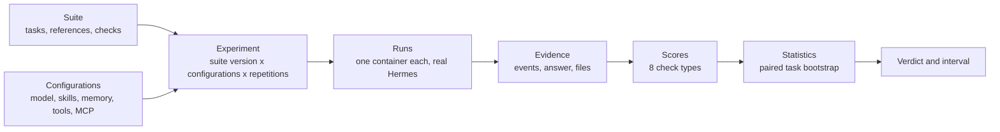
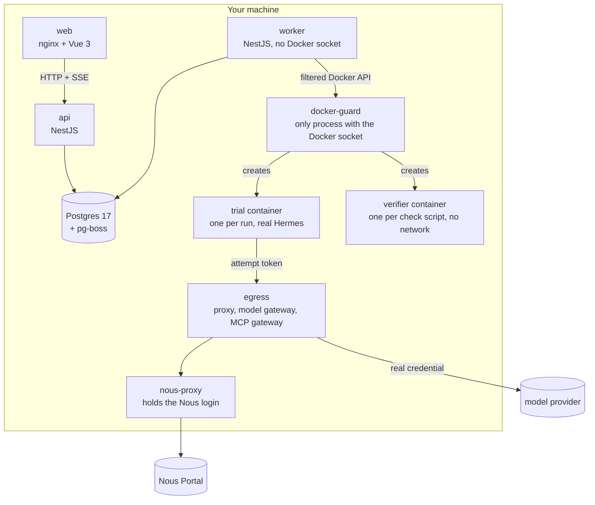
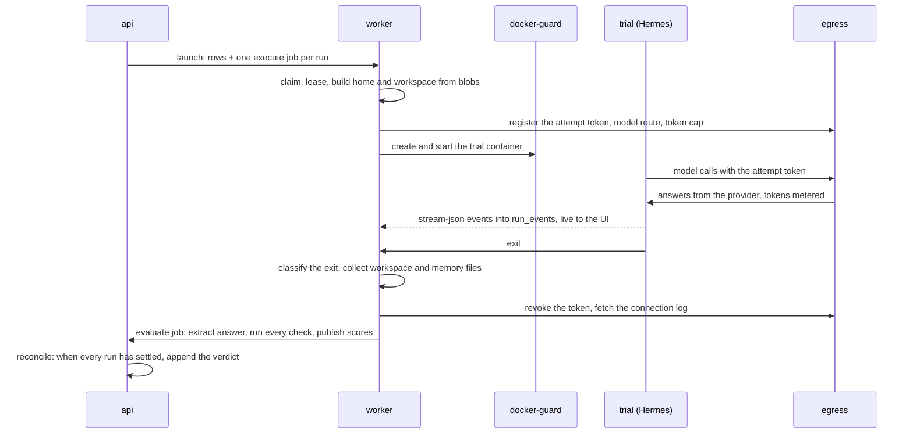

# Design

Hermes Evals answers one question with evidence: when you change how a Hermes Agent is set up (its model, its skills, its memory, its tools, its MCP servers), does it get better, worse, or stay the same, and how sure can you be?

This document covers the architecture, the life of a run, how results are scored and compared, the key decisions with the alternatives we weighed, and the assumptions the system makes. The limits are in [limits.md](limits.md), the costs in [costs.md](costs.md), and the real experiment in [results.md](results.md). Each phase's own document in [phases/](phases/) has the detail behind every section here.

## 1. The model in one paragraph

A **suite** is a folder of tasks. Each task has a prompt, a hidden reference answer, files the agent works on, and declared **checks** that grade the run. A **configuration** describes the agent: model and provider, toolsets, skills, documents, MCP servers, memory, turn and time limits. An **experiment** runs every selected task under every selected configuration, several times each. Every run happens in a fresh, isolated container running the real Hermes, and the platform keeps the full event stream, the final answer and every file the agent wrote. Checks grade that stored evidence. A paired bootstrap over tasks turns the per-run results into a verdict (better, worse or inconclusive) with a 95% interval. Every number in the UI links to the evidence beneath it, down to a single tool call.



## 2. Architecture

One TypeScript monorepo (pnpm and Turborepo): a NestJS API and worker in one package, a Vue 3 web app, and shared zod contracts that both sides parse every request and response with. Postgres 17 holds everything, with pg-boss 12 as the job queue inside it. Docker Compose runs it all with one command.



| Service                                                               | Job                                                                                                                                                                                                                                                                                                                                                            |
| --------------------------------------------------------------------- | -------------------------------------------------------------------------------------------------------------------------------------------------------------------------------------------------------------------------------------------------------------------------------------------------------------------------------------------------------------- |
| `api`                                                                 | Validates and stores everything the user defines; launches experiments (rows and jobs in one transaction); serves reads and live updates (server-sent events); computes the comparison, cached by the experiment's results revision. Never touches Docker.                                                                                                     |
| `worker`                                                              | Claims jobs; prepares each run's directory from the blob store; asks the guard for the trial container; streams Hermes's output into the database; collects the files afterwards; scores; loads and saves suites; renews leases and recovers from crashes. Holds no provider credential.                                                                       |
| `docker-guard`                                                        | The only process with the Docker socket. It has no network, a read-only root and no capabilities, and serves the worker a filtered Docker API: it creates only trial and verifier containers whose spec it checks field by field (pinned image, uid 10000, read-only root, no capabilities, only the attempt's own volume paths and slot network).             |
| `egress`                                                              | The only way out of a trial. An HTTP CONNECT proxy that authenticates each run by its token and refuses private and internal addresses; an OpenAI-compatible model gateway that swaps the run's token for the real credential and meters tokens; an MCP gateway that adds the header values of remote MCP servers. Keys and header values never enter a trial. |
| `nous-proxy`, `nous-login`                                            | Hermes's own proxy, holding one Nous Portal login, and the device login the System page drives. In development a host-side `hermes proxy start` can stand in.                                                                                                                                                                                                  |
| `web`                                                                 | The Vue 3 app behind nginx.                                                                                                                                                                                                                                                                                                                                    |
| `mock-model` (profile `test`), `vendor-directory` (profile `samples`) | A scripted OpenAI-compatible model for free, deterministic tests, and a sample remote MCP server.                                                                                                                                                                                                                                                              |

## 3. The life of a run



- **Preparation.** A run's home and workspace are fresh directories built from content-addressed blobs: the task's fixtures, the configuration's documents and skills, any seeded memory files, and a generated `config.yaml` that pins every Hermes setting both arms must share (tool search off, no update checks, approvals off, explicit memory and background-review settings). The reference answer and the checks never enter the trial.
- **Execution.** The trial runs `hermes chat --oneshot --format stream-json` as uid 10000 on its own internal network, with a read-only root, no capabilities, CPU, memory, process and disk caps, a wall-clock budget and a turn limit. Its only way out is egress.
- **Exit.** The worker classifies how the run ended: answered, or an execution error with a category (`provider`, `timeout`, `setup`, `worker_lost`, `limit`, `other`). Retries are automatic only where they can help (a provider hiccup, a lost worker), never for a timeout or the token cap.
- **Evidence is immutable.** Events, files and finished attempts can't be changed or deleted; the database refuses it with triggers. Re-scoring creates a new evaluation generation and never touches the evidence.
- **Scoring is a separate job.** A wrong check is fixed by re-scoring, never by re-running the agent.

## 4. Scoring

The answer is the last fenced ```json block of the agent's final reply. When the reply has no fence but is exactly one JSON object, that object is taken as the answer and the evidence says it was unfenced. A task declares one **primary** check, which decides pass or fail, plus any secondary checks shown beside it.

| Check               | Grades                                                                                                    |
| ------------------- | --------------------------------------------------------------------------------------------------------- |
| `numeric_tolerance` | A number against the reference, absolute or relative tolerance                                            |
| `json_match`        | A JSON value or sub-path, key by key, optionally unordered                                                |
| `exact_match`       | A string, after declared normalisation                                                                    |
| `text_match`        | Phrases and a pattern in the answer, with partial credit                                                  |
| `file_check`        | A file the agent left in the workspace (or saved to memory): exists, columns, rows, JSON schema, contents |
| `trajectory_match`  | Tool calls: a count rule, or strict, unordered, subset or superset matching of the whole trajectory       |
| `llm_judge`         | A rubric, graded by the platform's judge model through egress, with its calls and cost recorded           |
| `verifier_script`   | The task author's Python script, run in its own container with no network                                 |

Results are four separate states that are never blurred: `passed`, `failed` (the agent was wrong), `error` (a check broke), and `ungradable` (no answer could be extracted). A run that never produced an answer is an `execution_error`.

**Self-checks.** When a suite loads, every check is run against the task's own reference, and must pass; checks of files also run against the untouched fixtures as a negative control, and must fail. A task whose checks don't pass on their own reference can't be selected for an experiment. This catches broken tasks before they cost a run.

## 5. Comparing configurations

For a candidate against the baseline, on the primary check (or a chosen check):

1. **Per-task pass rates.** For each task and configuration, the share of counted runs that passed. An execution error counts as not passed; a cancelled run is left out.
2. **Observed difference.** The mean over tasks of (candidate rate − baseline rate). Every task weighs the same.
3. **Interval.** A paired bootstrap over tasks: resample the task list with replacement 10,000 times, keeping each task's runs together, and take the 2.5th and 97.5th percentiles. The random generator is seeded from the experiment's id, so the same results always give the same interval.
4. **Verdict.** `better` if the whole interval is above zero, `worse` if it is below, `inconclusive` otherwise; `provisional` while runs are still going.
5. **Gate.** No verdict with fewer than 3 tasks, or fewer than 2 counted runs per task and configuration: the page says why instead.
6. **Sensitivity.** The same figure without execution errors and ungradable runs, shown beside the main one, so you can see whether a difference comes from the agent's answers or from runs that broke.
7. **Secondary metrics.** Median duration, mean tokens, cost, execution errors and ungradable runs per configuration, because a win can come with a price.

Each completed experiment appends its verdict to a history (with the cause: first completion, retry or re-score), so a verdict that later moves says what moved it.

## 6. Defining tasks

Suites are folders under `./suites`, and the files are the source of truth: you can edit them by hand and reload, or edit them in the browser. The browser writes a draft, checks it live against 13 readiness rules, and saves through the worker, which stages the whole folder, re-checks the disk for hand edits, swaps it in under a lock, and loads it like any other reload. Every change that loads creates a new numbered version; an experiment always keeps the version it ran on, and Duplicate offers the newest one, listing what changed. Tasks can also come from CSV or JSONL, or a whole suite from a zip, whose scripts need an explicit "I trust these scripts".

Five suites ship with the platform, each built to test one thing a configuration can change: `invoices-v1` (a method skill), `mcp-v1` (the same data through MCP servers or as files), `memory-v1` (memory off and on, with seeded memories), `knowledge-v1` (an invented format given as documents, preloaded skills or skills to find), and `tools-v1` (file, terminal and code-execution toolsets). Their fixtures and references are generated by seeded scripts, never typed by hand.

## 7. Key decisions

| Decision                                     | Alternatives considered                     | Why                                                                                                                                                                                                |
| -------------------------------------------- | ------------------------------------------- | -------------------------------------------------------------------------------------------------------------------------------------------------------------------------------------------------- |
| **A container per run**                      | A fresh `HERMES_HOME` per run on one host   | Hermes's file tools take absolute paths, its terminal runs as the same user with the same network, and its gateway daemon outlives the client. A fresh home is not isolation; only a container is. |
| **Credentials stay in egress**               | Passing provider keys into the trial        | Anything in the trial is readable by the agent's terminal. The trial gets a per-run token egress can revoke; egress holds the key.                                                                 |
| **A guard in front of Docker**               | Giving the worker the Docker socket         | The socket is root on the host. The guard accepts only two exact container shapes, so a worker bug can't create anything else.                                                                     |
| **Postgres + pg-boss**                       | Redis with BullMQ                           | One store: launching an experiment writes its rows and its jobs in one transaction, and jobs survive restarts without a second system to back up.                                                  |
| **Drizzle**                                  | Prisma                                      | SQL-first, with hand-written SQL migrations for the triggers and CHECK constraints that make evidence immutable and states valid in the database itself.                                           |
| **Paired bootstrap over tasks**              | A per-run binomial test                     | Runs of one task are correlated, and the question is about tasks in general. Resampling tasks with their runs together gives an honest interval; a per-run test overstates confidence.             |
| **Tasks as files with versions**             | Tasks only in the database                  | Files can be reviewed, diffed and committed with git. The UI writes the same files, and versions are numbered by content, so an experiment's results always describe exactly what was tested.      |
| **A fixed set of check types, plus scripts** | Arbitrary scorer code                       | Every built-in check can be self-checked against the reference. Scripts are allowed for what the types can't express, but run in their own container.                                              |
| **Execution and scoring as separate jobs**   | Scoring inside the run                      | A scoring bug is fixed by re-scoring stored evidence, with no new model calls.                                                                                                                     |
| **One judge, owned by the platform**         | Judging with each configuration's own model | The same judge grades every arm, so the judge doesn't vary with the thing being compared. Its calls go through egress and are recorded with their cost.                                            |
| **Trajectory modes from openevals**          | Writing our own                             | The strict, unordered, subset and superset semantics are already well defined there; we copied them rather than invent new ones.                                                                   |
| **The run inspector as a drawer**            | A separate run page                         | You open runs from the comparison grid and the runs table; a drawer keeps your place, and arrow keys move to the next run.                                                                         |

## 8. Assumptions

- **One user, on their own machine.** There is no login or access control; the API listens on 127.0.0.1 only.
- **Suites are trusted content.** Verifier scripts are code. They run in a container with no network, and a zip import asks before it brings any in, but a suite is assumed to come from you or someone you trust.
- **One Hermes revision.** Every run uses Hermes v0.22.4 at revision 4d04303, pinned by digest, so results are comparable. A new revision is a deliberate upgrade.
- **Answers are JSON or files.** A task's answer is a JSON value in the final reply, or files the agent leaves in its workspace or memory.
- **Each run starts from nothing.** No memory, session history or files carry over between runs; memory is tested with seeded files and with what the agent saves within one run.
- **Costs are list prices.** Cost is tokens times the price table in `config/prices.yaml`, which records where each price came from and when it was checked.
- **macOS with Colima or Docker Desktop.** Both are tested from a clean install; Linux with native Docker should work but is untested.
